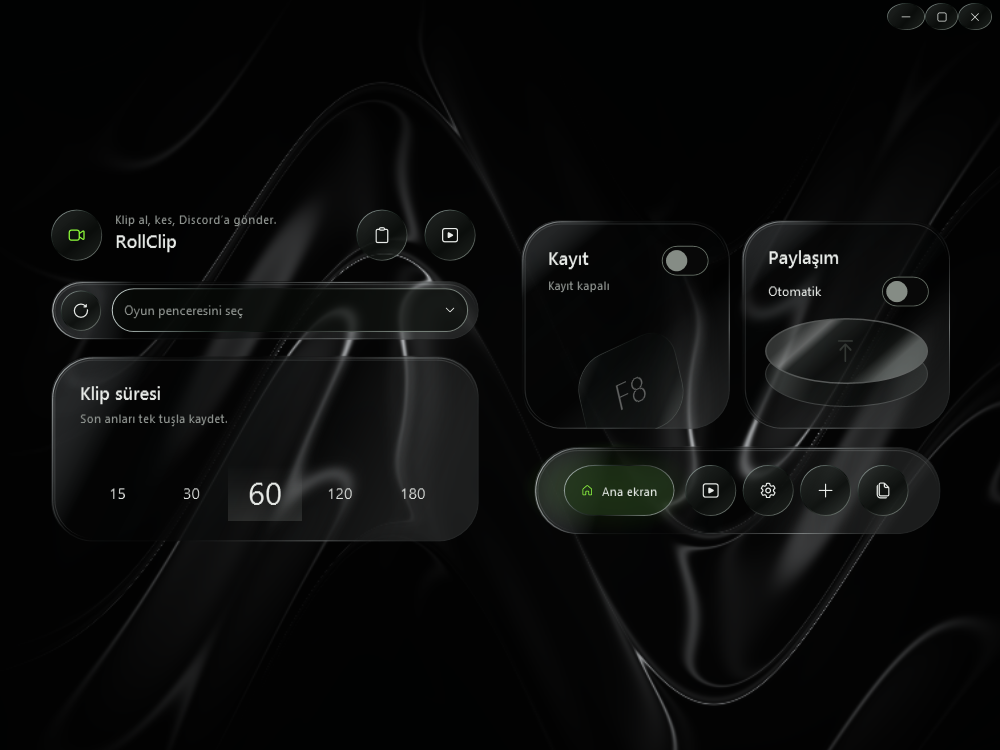
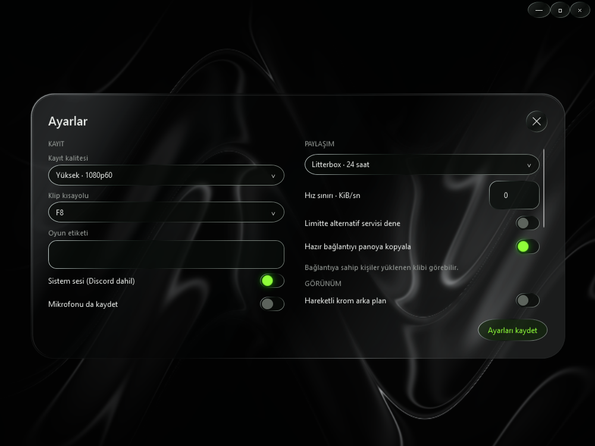
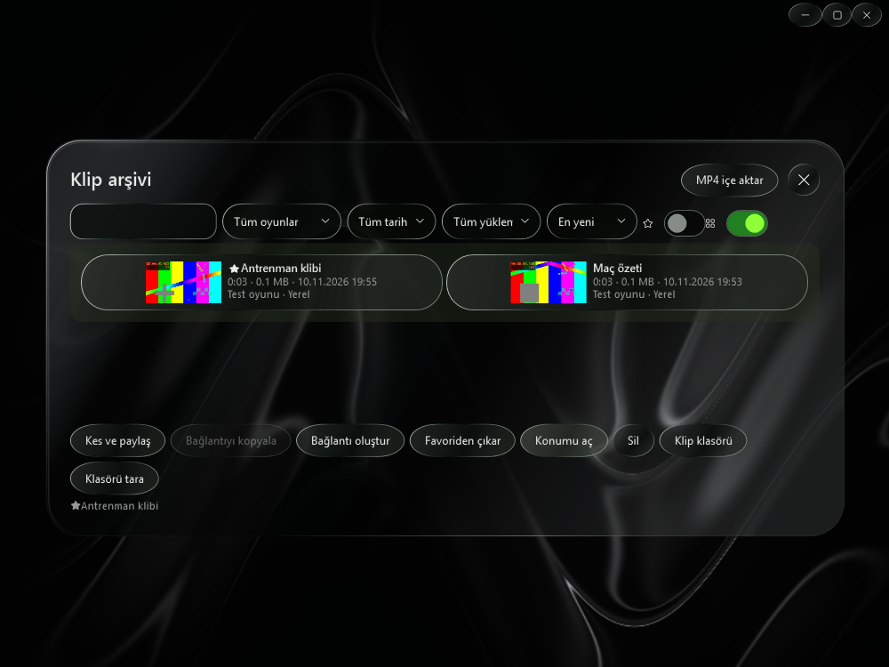
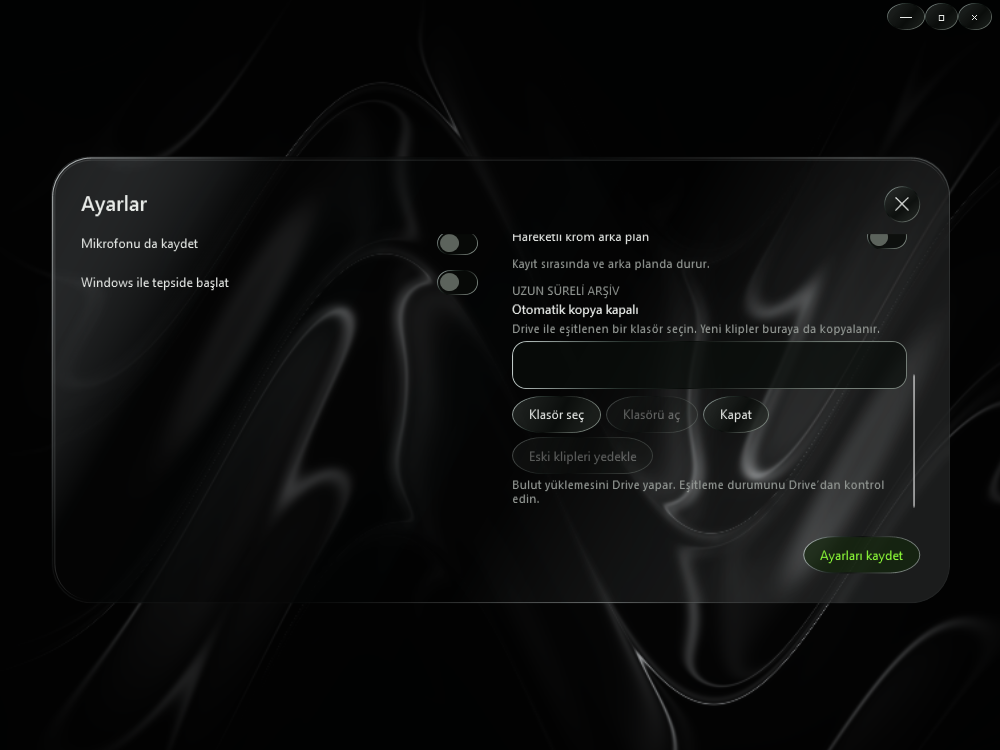

# RollClip

Windows 11 x64 için ücretsiz, MIT lisanslı klip arşivi ve paylaşım uygulaması. Windows'un pencere yakalama API'siyle F8 klipleri alabilir veya hazır bir MP4'ü içe aktarabilirsiniz. Kayıt motoru ZIP paketinin içindedir.

## İndir ve çalıştır

[RollClip-win-x64.zip’i indir](https://github.com/wozeky/RollClip/releases/download/v0.1.0/RollClip-win-x64.zip). ZIP'in tamamını bir klasöre çıkarıp `RollClip.exe` dosyasını çalıştırın. Paket .NET çalışma zamanını içerir. Erken sürüm dijital olarak imzalanmamıştır. Derlemelerin test sonuçları [Windows Actions](https://github.com/wozeky/RollClip/actions/workflows/windows.yml) sayfasında yer alır.

## Ekran görüntüleri

| Ayarlar | Klip arşivi |
| --- | --- |
|  |  |

## ClipBridge'den geçiş

Eski uygulamadan sistem tepsisindeki **Çıkış** ile çıkın ve yeni paketi açıp
`RollClip.exe` dosyasını çalıştırın. RollClip klasörü yoksa mevcut ClipBridge
veri ve video klasörleri yerinde kullanılır. Böylece arşiv yolları, ayarlar,
klipler ve bekleyen yüklemeler korunur. Yeni kurulumlar RollClip klasörlerini
kullanır. İlk açılış eski Windows başlangıç kaydını RollClip'e taşır.

## İlk klip

1. **MP4 içe aktar** ile yerel bir video seçin. RollClip orijinali korur, Windows Videolar klasörü altındaki `RollClip` klasörüne bir kopya koyar.
2. **Yükle / yeniden dene** ile yüklemeyi başlatın. Her yeni klibin arka planda yüklenmesi için **Ayarlar → Yeni klipleri otomatik yükle** seçeneğini etkinleştirin ve ayarları kaydedin.
3. Hazır bağlantıyı Discord'a yapıştırın. Varsayılan pano ayarı bağlantıyı otomatik kopyalar. Önceki bağlantılar arşivden tekrar kopyalanabilir.

Kütüphane ve ayarlar `%LOCALAPPDATA%\RollClip` altında saklanır. Uygulama pencere kapatıldığında tepsiye iner. Tepsideki **Çıkış** RollClip'i kapatır. Bekleyen yüklemeler sonraki açılışta devam eder. Önceki isteğin sunucuya ulaşıp ulaşmadığı belirsiz kalan kesintilerde arşivden tekrar deneyebilirsiniz. Yerel video dosyaları korunur.

## F8 ile replay

1. Oyunu açın. RollClip'de **Pencereleri yenile** ile oyun penceresini seçin.
2. İstiyorsanız **Yeni klipleri otomatik yükle** seçeneğini açın. **Sistem sesi** açıkken Discord ve diğer uygulamaların sesi de kayda girebilir. Mikrofon ayrı bir seçenektir.
3. **Kaydı başlat** düğmesine basın. Varsayılan hedef 60 saniyedir. Tampon doldukça daha uzun klip alabilirsiniz.
4. **F8** ile son tamamlanan parçalar MP4'e kaydolur. Kesim yaklaşık bir saniyelik parçalara göre yapılır. Otomatik yükleme açıksa bağlantı arşive eklenir ve pano ayarı açıksa panoya kopyalanır.
5. **Kaydı durdur** ile geçici tamponu kapatın. Kalıcı MP4 dosyaları Videolar altındaki `RollClip` klasöründe kalır.

**Ayarlar → Kayıt kalitesi** bölümünde **Yüksek (1080p60)**, **Dengeli (1080p30)** veya **Hafif (720p30)** seçin. **Klip kısayolu** için F6–F11 kullanılabilir. Varsayılan F8’dir. İki ayar da sonraki kayıt oturumunda uygulanır.

Yakalama yalnızca seçilen pencereyi hedefler. Kayıt, seçilen profil için sırasıyla NVIDIA NVENC ve AMD AMF donanım kodlamasını dener. Yazılımsal Media Foundation yedeği 720p30 kullanır. Windows Graphics Capture başlatılamazsa aynı pencere için Windows GDI denenir. GDI, donanım hızlandırmalı bazı oyunlarda boş görüntü verebilir. Kullanılan yakalama yöntemi, kodlayıcı ve kayıt biçimi durum satırında görünür.

## Google Drive arşivi

1. Google Drive for desktop uygulamasında eşitlenen **Drive’ım** klasöründe bir RollClip arşiv klasörü oluşturun.
2. RollClip’te **Ayarlar → Uzun süreli arşiv → Klasör seç** ile bu klasörü seçin ve ayarları kaydedin.
3. Yeni klipler arka planda yıl ve ay klasörlerine kopyalanır. Bekleyen otomatik kopyalar, aynı klasör seçiliyken RollClip yeniden açıldığında tekrar denenir.
4. **Klasörü aç** ile yerel kopyalara ulaşın. Var olan klipler veya başarısız kopyalar için **Eski klipleri yedekle** düğmesini kullanın. Aynı adlı bir dosya varsa içerik doğrulanır ve mevcut dosyanın üzerine yazılmaz.

RollClip yerel kopyayı oluşturur. Drive’a yüklemeyi Google Drive for desktop yapar. Eşitleme tamamlanınca dosyayı Drive web arayüzünde kontrol edin. Paylaşım bağlantısının sona ermesi arşivdeki MP4’ü etkilemez.

## Tanılama raporu

Kayıt denemesi bittikten sonra **Tanılama raporunu kopyala** düğmesine basın. Rapor bu oturumdaki son kayıt denemesini, son kaydedilen klibi ve paylaşım durumunu gösterir. MP4 hazır olduktan sonraki süre, varsa yükleme sırasını ve yeniden denemeleri de içerir. Rapor yerelde hazırlanır. Ham hata çıktısı yerine bilinen hata türlerini gösterir ve kişisel yolları, pencere adlarını veya paylaşım bağlantılarını içermez.

## Yükleme sağlayıcıları

| Servis | Ücretsiz otomasyon | Paylaşım ve sınırlar |
| --- | --- | --- |
| [Litterbox](https://litterbox.catbox.moe/) | Hesapsız, multipart API | Varsayılan. Doğrudan HTTPS video bağlantısı, 24 saatlik saklama, RollClip üst sınırı 1 GB. |
| [Gofile](https://gofile.io/api) | Hesapsız yükleme sentetik bir videoyla doğrulandı | Paylaşım sayfası bağlantısı. Ücretsiz saklama ve erişim koşulları değişebilir. |
| [Catbox](https://catbox.moe/faq.php) | Hesapsız API | 200 MB, anonim dosyalarda iki yıl erişimsizlikten sonra silme. Geçici paylaşım için Litterbox seçildi. |
| [Pixeldrain](https://pixeldrain.com/api) | API anahtarı gerekir | Ücretsiz indirme kotası, önizleme ve saklama kuralları uygulanır. |
| [Streamable](https://streamable.com/pricing) | Ücretsiz plan mevcut. Ücretsiz API erişimi doğrulanamadı. | 250 MB, 10 dakika, 90 gün saklama, reklamlı oynatma. |

Paylaşım bağlantısına sahip kişiler yüklenen klibe erişebilir. İsteğe bağlı sağlayıcı geçişi yalnızca kesin dosya veya kota reddinde devreye girer. Ağ kesintilerinde aynı sağlayıcı sınırlı sayıda yeniden denenir. Aktarım tek dosyalık kuyrukla çalışır ve hız sınırı KiB/sn olarak ayarlanabilir. Discord önizlemesi, sağlayıcının ve Discord'un erişim durumuna bağlıdır. Türkiye'deki erişim ve gecikme yerel bağlantıdan ölçülmelidir.

## Geliştirme ve doğrulama

.NET 10 SDK ile `dotnet build RollClip.slnx` ve `dotnet test RollClip.slnx` çalıştırın. [Windows workflow'u](.github/workflows/windows.yml) testleri, self-contained win-x64 yayını ve WPF penceresi açılış kontrolünü çalıştırır.

`dotnet run --project tools/RollClip.Bench -- test.mp4 litterbox` komutu gerçek bir yükleme yapar. `gofile` ikinci seçenektir. Paylaşabileceğiniz sentetik MP4 kullanın. Araç gövdenin istemcide yazılmasını, sunucu yanıtı beklemesini ve bağlantının hazır oluşunu ayrı ölçer. Paylaşım bağlantısını geçici bir yerel arşivden yeniden okur. Litterbox için ilk video baytlarına kadar geçen süreyi ve dosya bütünlüğünü de kontrol eder. Gofile paylaşım sayfası için izlenebilirlik ölçümü yoktur.

Kayıt mimarisi ve kaynak incelemesi için [Windows kayıt motoru notlarına](docs/recording.md) bakın. Windows CI, sentetik görüntü ve sesle ardışık MP4 dışa aktarmayı sınar. Ayrıca barındırılan Windows oturumunda gerçek pencere yakalama adımı çalıştırılır. Bu adımın sonucunu workflow logundan kontrol edin.

Gerçek oyunda F8, NVENC, FPS etkisi, ses senkronu ve anti-cheat davranışı fiziksel Windows testinde ölçülmelidir.

## Siyah krom arayüz

Ana ekran, sağlanan hareketli referansın panel oranlarını kullanır. Pencereyi üstteki kapsülden seçin; soldaki **15 / 30 / 60 / 120 / 180** seçeneklerinden süreyi belirleyin. **Kayıt** kartındaki anahtarla kaydı başlatın ve **F8** ile klip alın. Alttaki kapsülden arşive ve ayarlara ulaşabilirsiniz. Paylaşım kartındaki **Otomatik** anahtarı yeni kliplerin yüklenmesini açar. Krom yükleme düğmesi arşivde seçili klibi yükler.

Yeni kurulumlarda arka plan sabittir. **Ayarlar → Görünüm → Hareketli krom arka plan** ile hareket açılabilir. RollClip arka plandayken hareket duraklar. Kayıt başladığında veya hareket kapatıldığında video çözücüsü kapanır ve aynı krom materyalin sabit görüntüsü kullanılır. [Referans ölçümleri, uygulama ayrıntıları ve bilinen sınırlar](docs/ui-reference.md).
